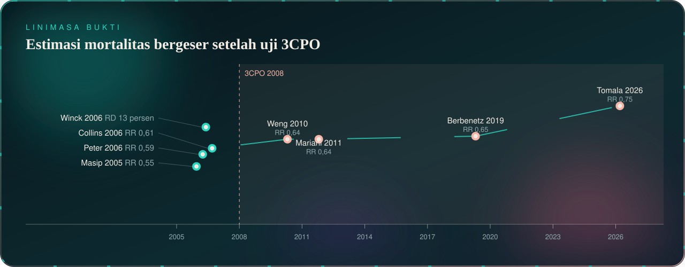
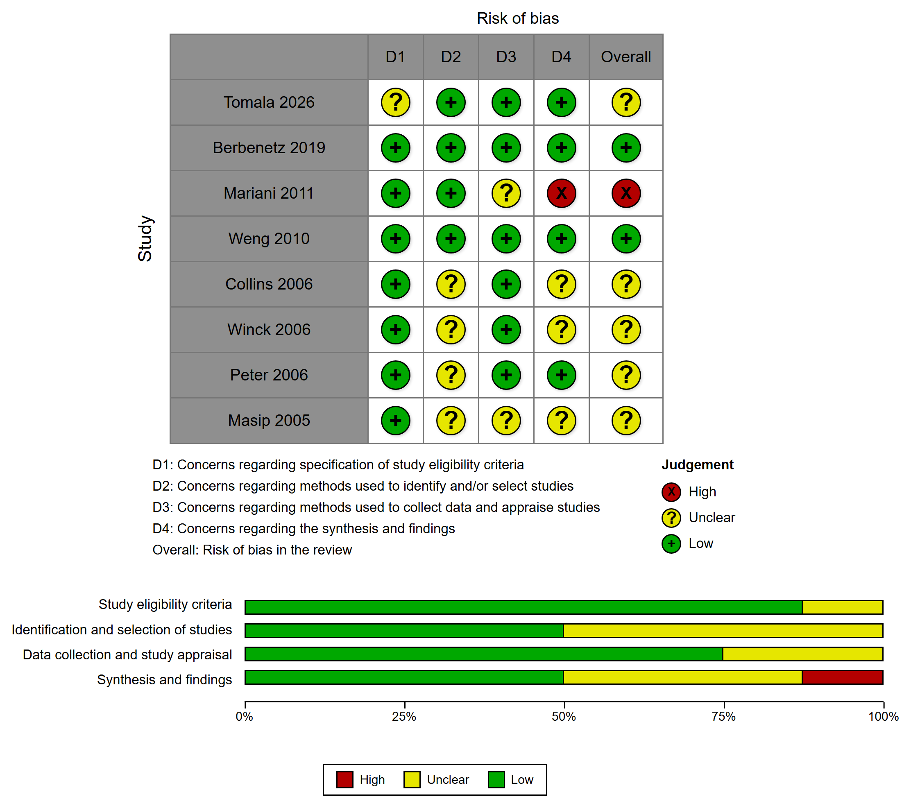
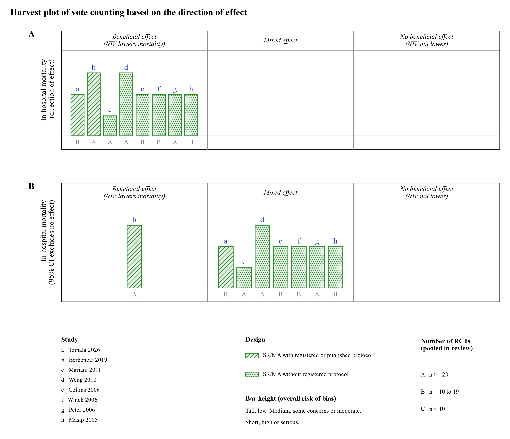
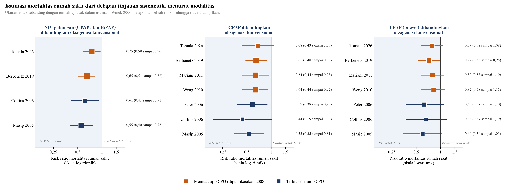
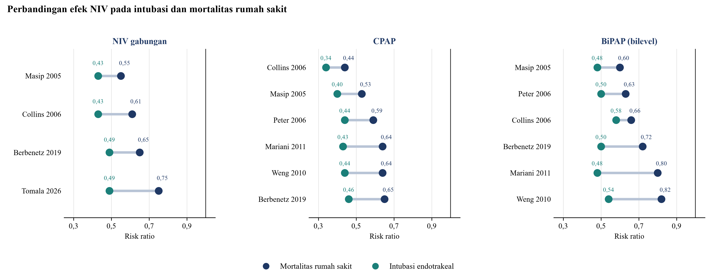

  

<h3 align="center">Efektivitas Ventilasi Noninvasif dibandingkan Oksigenasi Konvensional terhadap Mortalitas Rumah Sakit pada Pasien Dewasa dengan Edema Paru Kardiogenik Akut</h3>

  Laporan kasus berbasis bukti untuk Modul Praktik Klinik Ilmu Penyakit Dalam, Fakultas Kedokteran Universitas Indonesia, Oktober 2026

  

## Ringkasan

Pasien perempuan 58 tahun datang ke instalasi gawat darurat dengan sesak napas, tekanan darah 183/103 mmHg, saturasi 83 persen pada udara ruangan, dan edema paru pada foto toraks. Hemoglobin 4,4 g/dL dan penyakit ginjal menyertai gambaran tersebut. Pertanyaan klinisnya adalah apakah CPAP atau BiPAP menurunkan mortalitas rumah sakit dibandingkan oksigenasi konvensional.

Delapan tinjauan sistematik dari uji klinis acak yang terbit antara 2005 dan 2026 ditelaah secara kritis. Semuanya menunjukkan arah penurunan mortalitas. Penurunan intubasi jauh lebih konsisten daripada penurunan kematian, dan analisis yang dibatasi pada uji berisiko bias rendah tidak lagi bermakna untuk mortalitas.

  

  

## Seleksi studi

Pencarian pada tujuh basis data dan penelusuran manual 12 jurnal Indonesia dilaporkan sesuai PRISMA 2020. String Boolean lengkap, tanggal pencarian, dan jumlah rekaman tersedia pada folder `search`.

  

## Telaah kritis

Setiap tinjauan dinilai dengan lembar CEBM Oxford, CASP 2024, dan daftar tilik JBI. Risiko bias tinjauan dinilai dengan ROBIS, dan kepastian bukti dengan GRADE. Seluruh jawaban disertai kutipan langsung dari naskah asli dan nomor halaman.

  

<table>
  <tr>
    <td width="50%"></td>
    <td width="50%"></td>
  </tr>
  <tr>
    <td width="50%"></td>
    <td width="50%"></td>
  </tr>
</table>

## Isi repositori

| Folder | Isi |
| --- | --- |
| `manuscript` | Naskah lengkap dari sampul sampai lampiran |
| `figures` | Diagram PRISMA, risiko bias, harvest plot, forest plot, dan tabel GRADE |
| `search` | Hasil pencarian Boolean dan diagram alir PRISMA |
| `screening` | Contoh lembar skrining dengan angka sesuai PRISMA |
| `data` | Dataset harvest plot |

## Metode

Naskah disusun dengan PRISMA 2020. Referensi dikelola dengan Zotero dan setiap DOI telah dicocokkan dengan Crossref. Pada lembar skrining, hanya delapan studi yang disertakan merupakan studi sebenarnya, sedangkan rekaman lain berfungsi sebagai contoh alur.

## Catatan data pasien

Identitas pasien disamarkan dengan inisial dan nomor rekam medis dihapus dari salinan yang dipublikasikan di sini.

  

